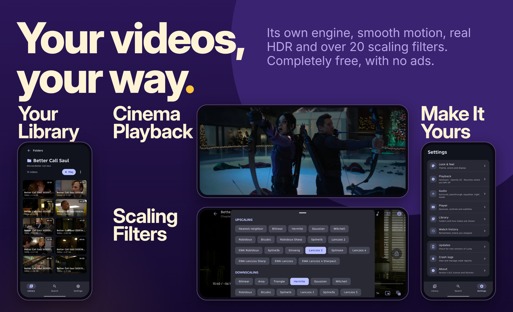
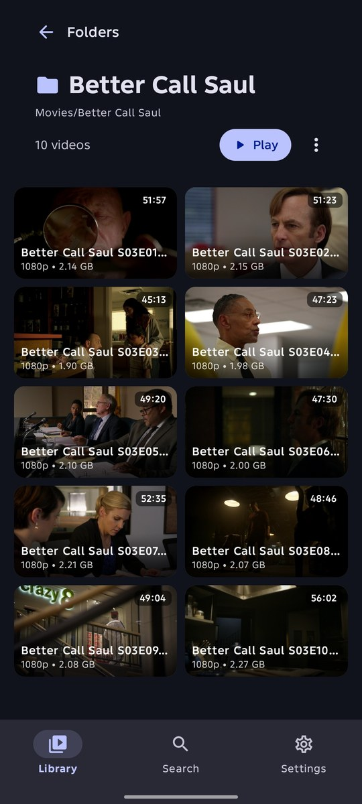
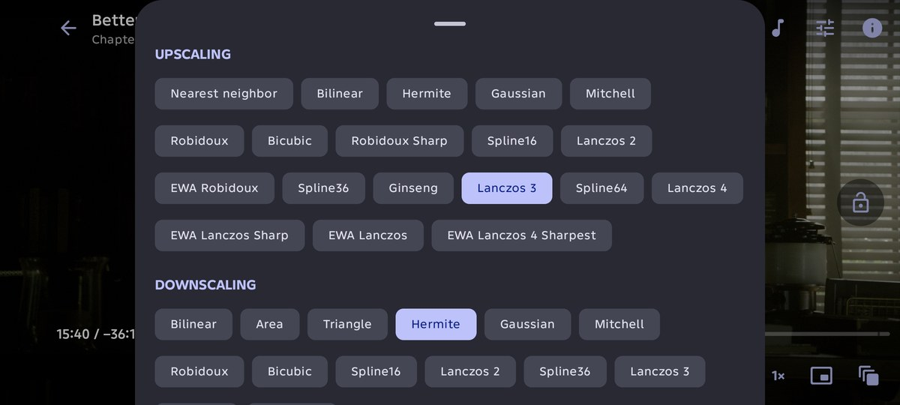
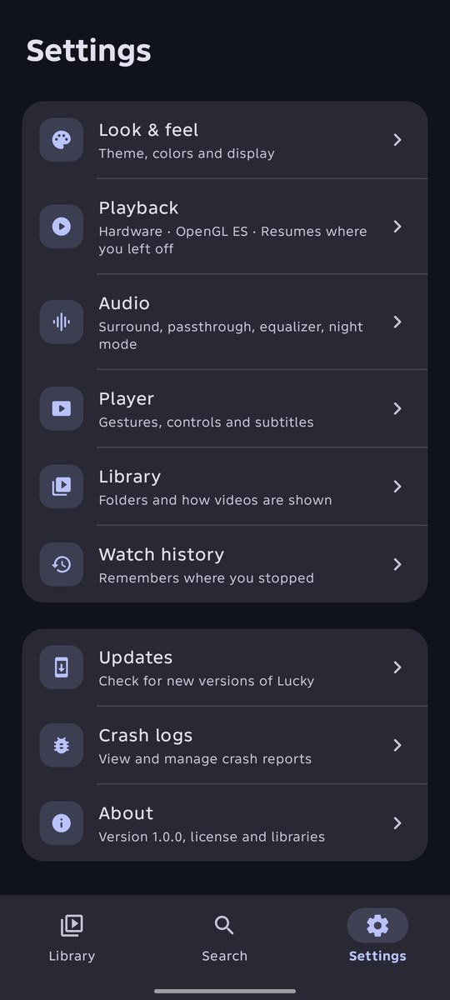

<div align="center">


# Lucky

**Local Utility Cinema Kit for You**

Your videos, your way.

[](LICENSE)
[](https://developer.android.com)
[](https://github.com/jhaiian/Lucky/releases/tag/v1.0.0)
[](https://github.com/jhaiian/Lucky/releases/tag/v1.0.0)
[](https://github.com/jhaiian/Lucky/releases)
[](https://github.com/jhaiian/Lucky)



[Download](#-download) • [Features](#-features) • [Screenshots](#-screenshots) • [Support](#-support-lucky) • [License](#-license)

</div>

---

## 🎬 What is Lucky?

Lucky is an open-source video player for the videos already on your phone. No accounts, no streaming, no ads. Just your library, played back with a picture and sound that rival a home theater.

- **Its own engine**: Lucky doesn't rely on Android's player. It has its own engine, written in Rust on top of FFmpeg and dav1d, so it plays almost any format on any phone.
- **Looks stunning**: real HDR, smooth motion, and over 20 scaling filters, drawn with Vulkan or OpenGL ES.
- **Sounds like a theater**: surround up to 7.1, passthrough to your receiver, an equalizer, and a night mode.

Lucky is part of the same Jhaiian ecosystem as [Kate](https://github.com/jhaiian/Kate), [Clint Gecko](https://github.com/jhaiian/ClintGecko), and [Clint Browser](https://github.com/jhaiian/ClintBrowser).

Built and maintained by **[@jhaiian](https://github.com/jhaiian)**, a solo developer from the Philippines 🇵🇭

---

## 📸 Screenshots

<div align="center">
  <table>
    <tr>
      <td align="center"></td>
      <td align="center"></td>
      <td align="center"></td>
      <td align="center"></td>
    </tr>
    <tr>
      <td align="center"><b>Your Library</b></td>
      <td align="center"><b>Cinema Playback</b></td>
      <td align="center"><b>Scaling Filters</b></td>
      <td align="center"><b>Make It Yours</b></td>
    </tr>
  </table>
</div>

---

## ✨ Features

### 🖼️ Picture

Lucky draws every frame itself, so you decide how your videos look.

- **Over 20 scaling filters** for upscaling and downscaling, from Bilinear and Bicubic to Spline, Lanczos, Ginseng, and EWA Lanczos. Each one tells you how sharp it is and how much GPU power it needs, and anti-ringing cleans up halos around edges.
- **Automatic quality** switches to a lighter filter when your GPU can't keep up, then goes back when it can. Lucky remembers what your phone can handle.
- **Real HDR** for HDR10, HLG, and Dolby Vision on screens that support it. On other screens, Lucky tone maps HDR scene by scene so highlights and dark scenes keep their detail.
- **Wide color** with your screen's full Display P3 range, and an optional brightness boost while HDR plays.
- **Deinterlacing** that cleans up DVDs, TV recordings, and 1080i broadcasts automatically.
- **Hardware or software decoding**, with fast AV1 through dav1d. If hardware decoding keeps failing, Lucky restarts it and falls back to software only when it has to.

### 🌊 Smooth motion

- **Frame blending** in Sharp or Smooth modes takes the stutter out of slow pans on 60 Hz and 90 Hz screens.
- **Motion interpolation** creates real in-between frames by tracking motion in the video. Pick a quality and a target frame rate, or let Lucky measure your phone and choose.
- **Anime mode** skips repeated drawings so animation flows between the real ones.
- **Artifact protection and scene-cut detection** keep halos and morphing shots away.
- **Match screen speed** switches your screen to a refresh rate that fits the video.
- **Battery and heat aware.** It can turn off in battery saver and ease off when your phone gets hot.

### 🎧 Sound

- **Lucky decodes every audio format itself**, so DTS, Dolby, FLAC, and Opus play on any phone.
- **Surround sound up to 7.1** when the connected output can play it, like HDMI or USB audio.
- **Passthrough** for Dolby Digital, Dolby Digital Plus, DTS, DTS-HD, and Dolby TrueHD to your receiver or TV.
- **Equalizer** with presets like Cinema, Vocal, and Bass boost, or drag the bands yourself.
- **Night mode** softens loud scenes and lifts quiet dialogue, **dialogue boost** makes voices clearer, and **volume normalization** uses ReplayGain when a file has it.
- **Volume boost, audio delay, balance, mono, and swapped channels.**

### 💬 Subtitles

- **libass rendering** for styled ASS and SSA subtitles, and better formatting for SRT and WebVTT too.
- **Load subtitle files** from your phone, and adjust the delay and size while you watch.
- **Style them your way:** size, color, bold, outline, drop shadow, or a dark box, with a live preview. Or follow Android's caption settings.
- **Picks the right track.** Forced and default subtitles turn on by themselves, and audio follows your preferred language.

### ▶️ Player

- **Gestures:** swipe for brightness and volume, swipe to seek, double-tap to skip, pinch to zoom, and press and hold to speed up.
- **Five seek bars:** Classic, Thin, Thick bar, Squiggle, and Dots, with eight icon colors.
- **Picture-in-picture**, chapters, A–B repeat, a sleep timer, frame-by-frame stepping, and speed control.
- **Remove black bars** automatically, crop, zoom, pan, mirror, or rotate the video.
- **Screenshots** of any frame, ready to open or share.
- **Lock the screen** so nothing interrupts the movie, and choose which quick buttons show under the seek bar.
- **Playback stats** with the decoder, renderer, HDR format, scaling filter, and frames shown or dropped.

### 📚 Library

- **Finds your videos by itself**, or only looks in the folders you pick.
- **Continue watching, recently added, folders, and history**, with resume right where you stopped.
- **Grid or list**, sorting, an alphabet index, a draggable scrollbar, and badges like 4K, HD, and HDR.
- **Search** through all your videos and folders.
- Watch history stays on your device, and you can turn it off or clear it.

### 🎨 Looks like yours

- **Light, dark, or system theme**, with accent colors, Material You, and adjustable surface intensity.
- **Hide the status and navigation bars**, and choose rounded or sharp thumbnail corners.
- **Adaptive layout** that fits phones, tablets, foldables, and wide screens.
- **Eight languages:** English, Spanish, Filipino, Hindi, Indonesian, Brazilian Portuguese, Russian, and Simplified Chinese.

> Just download the app and explore it yourself.

---

## ⬇️ Download

Get the latest APK from GitHub, or add Lucky to Obtainium to get updates automatically. Lucky needs Android 8.0 (API 26) or higher.

<a href="https://github.com/jhaiian/Lucky/releases/latest"></a>
<a href="https://apps.obtainium.imranr.dev/redirect?r=obtainium://add/https://github.com/jhaiian/Lucky"></a>

To build it yourself you need JDK 17, NDK `30.0.16248370`, Rust 1.85 or newer, and [cargo-ndk](https://github.com/bbqsrc/cargo-ndk):

```
./gradlew assembleGithubRelease
```

---

## 💜 Support Lucky

### Help Keep Lucky Free Forever

Lucky is an independent project built by one developer who thinks everyone should get a good video player without ads, paywalls or locked features. Donations help pay for development and maintenance, and Lucky will always be free.

Thank you for being part of this journey. 💜

[](https://patreon.com/Jhaiian)
[](https://ko-fi.com/jhaiian)
[](https://paypal.me/jhaiian)
[](https://github.com/jhaiian/jhaiian/blob/main/docs/Insta%20Pay.jpg)

---

## 🤝 Contributing

Contributions, bug reports, and feature requests are welcome.

1. [Open an issue](https://github.com/jhaiian/Lucky/issues) to report a bug or suggest a feature.
2. Fork the repo and create a branch for your change.
3. Submit a pull request with a clear description.

---

## 💬 Community

Join the official Lucky community on Discord and Reddit to share feedback, report bugs, and connect with other users.

- **Discord** – [discord.gg/6sPXKt3h49](https://discord.gg/6sPXKt3h49)
- **Reddit** – [reddit.com/r/LuckyVideoPlayer](https://www.reddit.com/r/LuckyVideoPlayer)

---

## ⭐ Star History

<a href="https://www.star-history.com/?repos=jhaiian%2Flucky&type=date&legend=top-left">
 <picture>
   <source media="(prefers-color-scheme: dark)" srcset="https://api.star-history.com/chart?repos=jhaiian/lucky&type=date&theme=dark&legend=top-left" />
   <source media="(prefers-color-scheme: light)" srcset="https://api.star-history.com/chart?repos=jhaiian/lucky&type=date&legend=top-left" />
   
 </picture>
</a>

---

## 📄 License

The source code of this project is licensed under the [GNU General Public License v3.0 (GPLv3)](LICENSE).

The name "Lucky," the logo, screenshots, and all related branding assets are **trademarks** or **proprietary assets** of the author and are **not licensed under the GPL**. Using them requires explicit permission from the author.

The libraries used in Lucky keep their own licenses, including FFmpeg (LGPL-2.1-or-later), dav1d (BSD-2-Clause), jni-rs, ash and glow (MIT / Apache-2.0), and Jetpack Compose (Apache-2.0). The full list is in the app under Settings → About.
# Lucky
